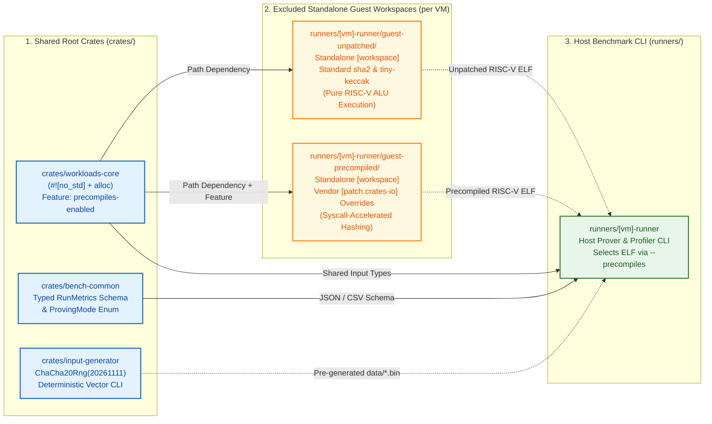
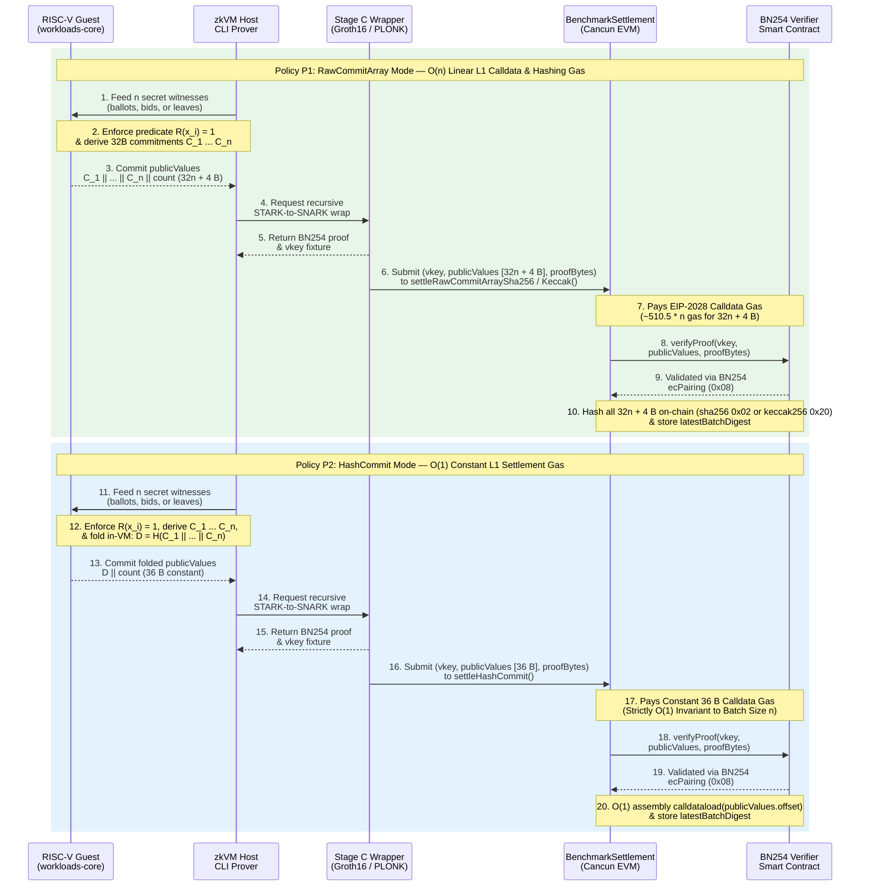

# System Design Diagrams (Test Run #2)

This directory contains the Mermaid source definitions, layout configuration, and rendered vector PDF diagrams for the **Test Run #2 Multi-zkVM and EVM Gas Benchmarking Suite**:

- **Mermaid Layout Configuration**: [`mermaid-config.json`](./mermaid-config.json)
- **Diagram 1 (7-Layer End-to-End Pipeline)**: [`system_design.mmd`](./system_design.mmd) | [`system_design.pdf`](./system_design.pdf)
- **Diagram 2 (Host-Guest Workspace Isolation)**: [`host_guest_isolation.mmd`](./host_guest_isolation.mmd) | [`host_guest_isolation.pdf`](./host_guest_isolation.pdf)
- **Diagram 3 (On-Chain EVM Settlement Sequence $`\mathcal{P}_1`$ vs. $`\mathcal{P}_2`$)** : [`evm_settlement_sequence.mmd`](./evm_settlement_sequence.mmd) | [`evm_settlement_sequence.pdf`](./evm_settlement_sequence.pdf)

---

## 1. End-to-End System Design & Experimental Pipeline

```mermaid
flowchart TB
    classDef inputLayer fill:#e3f2fd,stroke:#1565c0,stroke-width:2px,color:#0d47a1
    classDef coreLayer fill:#e8f5e9,stroke:#2e7d32,stroke-width:2px,color:#1b5e20
    classDef guestLayer fill:#fff8e1,stroke:#f57f17,stroke-width:2px,color:#e65100
    classDef tierALayer fill:#f3e5f5,stroke:#6a1b9a,stroke-width:2px,color:#4a148c
    classDef tierBLayer fill:#fce4ec,stroke:#ad1457,stroke-width:2px,color:#880e4f
    classDef wrapLayer fill:#ede7f6,stroke:#4527a0,stroke-width:2px,color:#311b92
    classDef evmLayer fill:#fff3e0,stroke:#e65100,stroke-width:2px,color:#bf360c
    classDef metricsLayer fill:#eceff1,stroke:#37474f,stroke-width:2px,color:#263238

    subgraph L1["1. Deterministic Input Vector Layer (crates/input-generator & data/)"]
        direction LR
        PRNG["ChaCha20Rng::seed_from_u64(20261111)<br/>Zero Input-Creation Timing Drift"]:::inputLayer
        DIM["4D Input Space I = (W, n, b/M/L, P_io)<br/>Stage A: n in [1..1024] | Stage B: n in [1..64] | Stage C: n in [1..256]"]:::inputLayer
        VECTORS[("Pre-Generated Test Vectors (data/)<br/>Bit-Identical Witnesses Across All 5 zkVMs")]:::inputLayer
        PRNG --> DIM --> VECTORS
    end

    subgraph L2["2. Shared #![no_std] + alloc Workload Core (crates/workloads-core)"]
        direction TB
        subgraph Workloads["Five Privacy & State-Validation Predicates (W1 - W5)"]
            direction LR
            W1["W1: Voting & Nullifiers<br/>Binary (b=1) & One-Hot (k)<br/>N_i = SHA256(s_i || v^(i))"]:::coreLayer
            W2["W2: Sealed-Bid Auction<br/>Two-Word (u64, u64) Range<br/>R_min <= u_i < 2^b (b in 8..120)"]:::coreLayer
            W3["W3: Allowlist Membership<br/>Strict Sort Check + O(log M)<br/>Binary Search (M in 16..256)"]:::coreLayer
            W4["W4: Merkle State Proofs<br/>Depth d=8 Inclusion<br/>W4a: SHA-256 | W4b: Keccak-256"]:::coreLayer
            W5["W5: Fixed-Limb BigInt Math<br/>[u32; k] Montgomery Reduction<br/>z_i = x_i^e mod M_L (L in 256..2048)"]:::coreLayer
        end
        subgraph Policies["Public Journal Commitment Policy (P_io)"]
            direction LR
            P1["Policy P1: RawCommitArray<br/>Commits all n 32B items + 4B count<br/>Journal Size: 32n + 4 Bytes (O(n) L1 Gas)"]:::coreLayer
            P2["Policy P2: HashCommit / HashCommitKeccak<br/>In-VM Folding D = H(C_1 || ... || C_n)<br/>Journal Size: 36 Bytes (O(1) L1 Gas)"]:::coreLayer
        end
        Workloads --> Policies
    end

    subgraph L3["3. Compiler-Locked RISC-V Guest Compilation (opt-level=3, lto='fat', codegen-units=1)"]
        direction LR
        GUNPATCH["Isolated Guest Workspace: guest-unpatched/<br/>Pure RISC-V RV32I/RV32IM ALU Execution<br/>No Syscall Overrides"]:::guestLayer
        GPRECOMP["Isolated Guest Workspace: guest-precompiled/<br/>Isolated [patch.crates-io] Overrides<br/>Hardware/Syscall Accelerated sha2 & tiny-keccak"]:::guestLayer
    end

    subgraph L4["4. Multi-zkVM Execution & Proving Layer (runners/*-runner)"]
        direction LR
        subgraph TierA["Tier A: Full E2E Proving + On-Chain EVM Verifiable (RV32IM)"]
            direction TB
            SP1["SP1 (Succinct)<br/>Plonky3 FRI-STARK (BabyBear)<br/>Precompile Syscalls"]:::tierALayer
            R0["RISC Zero<br/>AIR FRI-STARK (BabyBear)<br/>Continuations + Accelerators"]:::tierALayer
            PICO["Pico (Brevis)<br/>Modular Plonky3 FRI-STARK<br/>(BabyBear / KoalaBear)"]:::tierALayer
        end
        subgraph TierB["Tier B: Alternative Arithmetization Paradigms (Off-Chain Trace & Core Proof)"]
            direction TB
            JOLT["Jolt (a16z)<br/>RV32I/IM Lasso Lookup-Singularity<br/>+ Sumcheck (BN254 / HyKZG)"]:::tierBLayer
            NEXUS["Nexus<br/>RV32I / Stwo VM<br/>Nova IVC Folding / Circle STARK (M31)"]:::tierBLayer
        end
    end

    subgraph L5["5. Stage C: Recursive STARK-to-SNARK Compression & Hardware Delegation"]
        direction LR
        SP1_WRAP["SP1 Network Prover<br/>BN254 Groth16 & PLONK"]:::wrapLayer
        R0_WRAP["RISC Zero Bonsai / Docker<br/>BN254 Groth16 Wrapper"]:::wrapLayer
        PICO_WRAP["Pico 64 GB Cloud Instance<br/>Dockerized gnark BN254 Groth16<br/>(Bypasses 48 GB Local M1 OOM)"]:::wrapLayer
    end

    subgraph L6["6. Stage D: Local Foundry / Anvil Cancun EVM Settlement (evm-profiler/)"]
        direction TB
        SETTLE["BenchmarkSettlement.sol + IZkVMVerifier.sol<br/>Verifies BN254 Proof (ecPairing 0x08)"]:::evmLayer
        subgraph GasPaths["On-Chain Public Journal Verification Paths"]
            direction LR
            EVM_P1_K["settleRawCommitArrayKeccak()<br/>EIP-2028 Calldata (32n+4 B)<br/>+ Opcode 0x20 (30 + 6w gas)"]:::evmLayer
            EVM_P1_S["settleRawCommitArraySha256()<br/>EIP-2028 Calldata (32n+4 B)<br/>+ Precompile 0x02 (60 + 12w gas)"]:::evmLayer
            EVM_P2["settleHashCommit()<br/>Constant 36 B Calldata<br/>+ O(1) calldataload Digest"]:::evmLayer
        end
        SETTLE --> GasPaths
    end

    subgraph L7["7. Standardized Metrics Matrix (crates/bench-common & results/)"]
        direction LR
        OFF_METRICS["Off-Chain Metrics (Stages A & B)<br/>C_user, C_predicate, C_padded, N_shards<br/>T_exec, T_core, M_peak (/usr/bin/time -l), pi_core"]:::metricsLayer
        ON_METRICS["On-Chain EVM Metrics (Stages C & D)<br/>T_wrap, pi_evm, G_data (16*B_nz + 4*B_z)<br/>G_exec, G_total, G_amort(n) = G_total/n"]:::metricsLayer
        FIGS["6 Publication Figures (scripts/05_plot_figures.py)<br/>G1: P1 vs P2 Gas Crossover | G2: Amortized Gas | G3: Shard Step-Functions<br/>G4: Bit-Width Invariance | G5: 8GB M1 RAM Ceiling | G6: Precompile vs BigInt Wall"]:::metricsLayer
        OFF_METRICS --> FIGS
        ON_METRICS --> FIGS
    end

    VECTORS --> Workloads
    Policies --> GUNPATCH
    Policies --> GPRECOMP
    GUNPATCH --> TierA
    GUNPATCH --> TierB
    GPRECOMP --> TierA
    GPRECOMP --> TierB

    SP1 --> SP1_WRAP
    R0 --> R0_WRAP
    PICO --> PICO_WRAP

    TierA --> OFF_METRICS
    TierB --> OFF_METRICS

    SP1_WRAP --> SETTLE
    R0_WRAP --> SETTLE
    PICO_WRAP --> SETTLE

    GasPaths --> ON_METRICS
```

---

## 2. Host-to-Guest Workspace Isolation & Precompile Dispatch

---

## 3. On-Chain Settlement Sequence: Policy $`\mathcal{P}_1`$ vs. Policy $`\mathcal{P}_2`$

